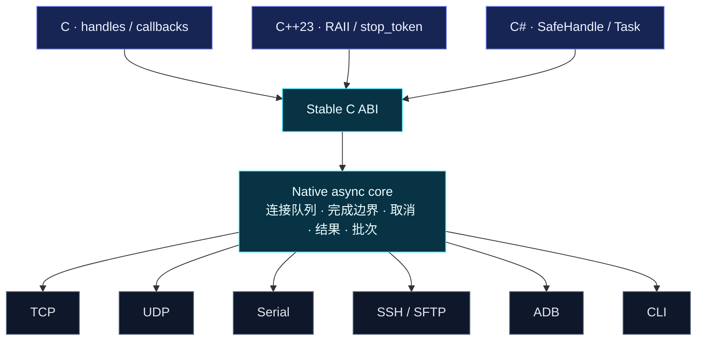

<div align="center">

# CommunicationDriver

**一个原生核心，连接设备、网络与命令行。**

One core. Every connection.

[](https://github.com/EurekaRaider/CommunicationDriver/actions/workflows/ci.yml)
[](CMakeLists.txt)
[](include/communicationdriver/communicationdriver.hpp)
[](bindings/dotnet/CommunicationDriver)
[](LICENSE)

[快速开始](#quick-start) · [构建与集成](#build) · [平台验证](#validation) · [文档导航](#docs)

</div>


CommunicationDriver 是面向设备控制、自动化测试和多连接编排的跨平台通信库。它将 **TCP、UDP、串口、SSH、ADB、CLI** 统一到同一套连接与操作模型中，以 **C++23 原生异步核心 + 稳定 C ABI** 为基础，为 C、C++ 和 C# 提供一致的运行语义。

从一条本地 shell 命令，到跨设备的并行批次：创建连接、打开资源、执行操作、检查回复、关闭连接，沿用同一条调用路径。

> **当前版本：0.1.0。** 已有六个 RID 的平台软件验收记录，NuGet 包从 CI 产物获取。真实 Android 设备与真实串口仍待硬件验收。详细范围见 [验证报告](docs/validation.md)。

## 为什么选择 CommunicationDriver

| 能力 | 为调用者解决的问题 |
| --- | --- |
| **六种后端，同一套 API** | 以统一的 `Open / Read / Write / Execute / Close` 模型切换通信方式 |
| **共享原生实现** | C ABI、C++ RAII 包装和 C# `SafeHandle` / `Task` 共用一个异步核心 |
| **明确的回复边界** | 按命令完成、长度、分隔符、正则或 UDP 消息完成收集；静默规则需显式选择 |
| **执行与检查分离** | `Execute` 收集完整回复后检查；`ExecuteUntil` 在持续接收中匹配并提前返回 |
| **批量并发编排** | 默认并发 32，同连接串行，结果按输入顺序返回，单项失败不取消其他项 |
| **可诊断的失败** | 超时、取消和 IO 故障保留部分文本、原始字节或文件路径，帮助调用者决定恢复方式 |
| **文本与字节并行支持** | 原始字节接口与 UTF-8 / ASCII / GB18030 传输编码，覆盖文本命令和二进制协议 |

## 六种连接方式

| 后端 | 常见用途 | 配置与使用要点 |
| --- | --- | --- |
| **TCP** | 网络设备、测试服务、流式协议 | TCP 客户端；通过 `ReceiveUntil` 定义完整回复边界 |
| **UDP** | 数据报协议、固定对端设备 | 固定对端；可按 UDP message 收集，`Open` 不代表远端在线 |
| **Serial** | 仪器仪表、控制板、串口设备 | 可配置波特率、数据位、校验位、停止位与流控 |
| **SSH** | 远程命令、持久 shell、SFTP | 密码或私钥认证；必须配置 known_hosts 或 SHA256 主机指纹 |
| **ADB** | Android shell、文件上传下载 | 固定 `DeviceSerial`；使用调用者提供的 Android Platform Tools |
| **CLI** | 本地 shell、工具链、子进程 | 支持持久 / 单次模式，以及直接程序、参数、工作目录与环境变量 |

## 架构：一套语义，一份实现



`Create` 复制并校验配置，`Open` 才连接设备或启动资源。每个连接串行处理操作，多个连接可并行执行。正常 `Close` 后可再次 `Open`；关闭 `Driver` 后不能创建或重新打开连接。

<a id="quick-start"></a>

## 快速开始

下面的 CLI 示例使用系统默认 shell，无需外部设备。Windows 默认为 CMD，macOS / Linux 默认为 sh；`echo READY` 在两种默认环境中都可运行。请先按 [构建与集成](#build) 准备原生库及语言包装。

### C#：执行、等待、检查

```csharp
using System;
using CommunicationDriver;

using var driver = new Driver();
using var connection = driver.CreateCli(new CliOptions
{
    ExecutionMode = ExecutionMode.OneShot
});

await connection.OpenAsync();

var result = await connection.ExecuteAsync(
    "echo READY",
    Check.Contains("READY")
);

Console.Write(result.Response);                       // READY
Console.WriteLine($"Verified: {result.Check.Passed}"); // Verified: True

await connection.CloseAsync();
```

C# 包装提供同步与异步方法，目标框架为 `net48` 和 `net10.0`。上例采用现代 C# 顶层语句；传统项目可放入 `async Task Main`。net48 运行仅支持 Windows。

### C++23：RAII 与异步操作句柄

```cpp
#include <communicationdriver/communicationdriver.hpp>
#include <iostream>

int main() {
    comm::Driver driver;
    comm::CliOptions options;
    options.execution_mode = comm::ExecutionMode::OneShot;

    auto connection = driver.create_cli(options);
    connection.open();

    auto pending = connection.execute_async(
        "echo READY", comm::Check::contains("READY")
    );
    auto result = pending.get();

    std::cout << result.response;
    connection.close();
    return result.check->passed ? 0 : 1;
}
```

`Operation<T>` 是可移动 RAII 句柄，`get()` 消费一次结果，`wait_for()` 仅观察完成状态。可通过 `std::stop_token` 请求取消；丢弃操作句柄不会自动取消。C 接口示例见 [examples/c](examples/c)。

### 切换到 TCP：先定义回复何时完成

假设目标服务在完整回复末尾发送 `END`，连接配置可以写为：

```csharp
using var connection = driver.CreateTcp(new TcpOptions
{
    Host = "127.0.0.1",
    Port = 9000,
    ReceiveUntil = ReceiveUntil.Delimiter("END")
});

await connection.OpenAsync();
var result = await connection.ExecuteAsync(
    "STATUS\n", Check.Contains("READY")
);
await connection.CloseAsync();
```

`Delimiter` 默认从返回内容中剥离分隔符。也可选择 `Bytes(n)`、`Characters(n)`、`Pattern(regex)`，或 UDP 专用的 `Message()`。`Execute` 发送给原始流的内容不会自动追加换行；示例中的 `\n` 是协议的一部分。

## 从单连接到并行批次

同一 `Driver` 下的不同连接可以组成批次。假设 `adb` 和 `serial` 已打开，且串口已配置正确的回复边界：

```csharp
var items = new[]
{
    BatchItem.Execute("UP01/adb", adb, "getprop ro.product.model"),
    BatchItem.Execute("UP01/serial", serial, "STATUS\n", Check.Contains("READY"))
};

var report = await Batch.RunAsync(items, new BatchOptions
{
    MaxConcurrency = 32
});

foreach (var item in report.Items)
    Console.WriteLine($"{item.Key}: {item.State}, passed={item.Succeeded}");
```

- **调度**：不同连接并行，同连接串行；32 是默认批并发数，不是连接总数上限。
- **结果**：key 必须唯一，报告按输入顺序返回；`Succeeded` 同时考虑操作成功和检查通过。
- **失败与取消**：单项失败不取消其他项；批取消保留已完成结果，未准入项标记为 `NotStarted`。
- **步骤屏障**：先 `await` 当前批次，再提交下一批次，即可按阶段推进多设备流程。

## 需要掌握的运行语义

| 操作或场景 | 约定 |
| --- | --- |
| `Execute` | 发送一次，收集到完成边界后检查；正常不匹配返回 `Check.Passed = false` |
| `ExecuteUntil` | 发送一次，持续接收并匹配 `Contains / Regex`；匹配即返回，可能尚无 `ExitCode` |
| 提前匹配后的清理 | 托管命令或有可靠协议边界的流会继续清理剩余输出；同连接的下一事务等待清理结束 |
| 原始流的完成规则 | TCP / UDP / 串口的普通 `Execute` 必须配置可靠的 `ReceiveUntil`；默认不猜测静默间隔 |
| `ReceiveUntil.Idle(...)` | 显式按静默完成，业务长停顿可能使回复提前结束；原始流 `Execute` 随后进入 `NeedsRecovery` |
| 超时与取消 | 单连接操作包含连接队列等待时间；错误携带部分结果，回复归属不明确时要求恢复 |
| `NeedsRecovery` | 对连接执行 `Close / Open` 后再继续；库不会隐式重发、重连或撤销远端副作用 |
| 文本与检查 | 默认 UTF-8；字符计数按 Unicode scalar value；RE2 正则区分大小写，不自动 trim 或移除 ANSI |
| 文件传输 | 单文件操作，默认允许覆盖；失败可能留下部分文件，路径通过 `ErrorInfo.PartialFile` 报告 |

持久 shell 可保留 `cd` 与环境状态；单次执行使用独立命令输出。指定 CLI `ExecutablePath` 与 `Arguments` 后，`Execute` 的 command 表示程序 stdin 内容。完整的生命周期、错误、编码和句柄所有权规则见 [API 语义](docs/api.md)。

<a id="build"></a>

## 构建与集成

### 工具链

| 组件 | 要求 |
| --- | --- |
| 原生构建 | CMake **3.28+**、支持所需 C++23 特性的编译器；下列命令使用 Ninja |
| C++23 特性 | `expected`、`coroutine`、`span`、`stop_token`，配置阶段会进行探测 |
| C# 包装 | **.NET SDK 10**，生成 `net48 / net10.0` 双目标程序集 |
| Unix SSH 加密 | OpenSSL 开发文件；Windows 使用系统 WinCNG |
| ADB 后端 | 调用者提供 Android Platform Tools；不随包分发 adb |

CI 使用 Linux GCC 14、Windows MSVC、macOS LLVM 21。依赖版本及源码 SHA256 已锁定，详细信息见 [依赖与许可](docs/dependencies.md)。

```sh
git clone https://github.com/EurekaRaider/CommunicationDriver.git
cd CommunicationDriver

cmake -S . -B build -G Ninja -DCMAKE_BUILD_TYPE=Release
cmake --build build --parallel 4
ctest --test-dir build --output-on-failure
cmake --install build --prefix install

dotnet build bindings/dotnet/CommunicationDriver -c Release
```

首次配置默认下载锁定依赖。已有依赖时可设置 `-DCD_FETCH_DEPENDENCIES=OFF`，其中 Boost 必须为 **1.92.0**，并提供 RE2 和 libssh2。macOS 使用自装 LLVM 时还需正确配置 libc++、SDK 与 OpenSSL 路径；可参考 [CI 工具链配置](.github/workflows/ci.yml)。

### C / C++ 消费者

安装后，在消费者 CMake 项目中使用导出目标：

```cmake
find_package(CommunicationDriver CONFIG REQUIRED)
target_link_libraries(your_app PRIVATE CommunicationDriver::communicationdriver)
```

配置消费者时将 `CMAKE_PREFIX_PATH` 指向上述 `install` 目录。C++ 消费者需启用 C++23。可直接参考 [独立 C / C++ 消费者](examples/consumer)。

### C# 与 NuGet

从 [Platform CI](https://github.com/EurekaRaider/CommunicationDriver/actions/workflows/ci.yml) 的成功运行下载 **`CommunicationDriver-NuGet`** 产物，将其中的 `.nupkg` 放入本地 NuGet 源，再使用 `PackageReference` 安装 **`CommunicationDriver` 0.1.0**。目前尚未发布到 nuget.org。

合并包包含 `net48 / net10.0`、六个 RID 的 native 库与第三方许可证。Windows 按 `PlatformTarget` 选择 `win-x86 / win-x64`；Unix 可设置 `RuntimeIdentifier` 或 `CommunicationDriverRid`。原生库位数必须与进程一致。

只执行上面的 `dotnet build` 会生成托管包装；运行时仍须提供匹配的原生库。完整的包引用及传统项目用法见 [PackageReference 示例](examples/dotnet/PackageConsumer) 和 [packages.config 示例](examples/dotnet/LegacyConsumer)。

| 系统 | 原生库文件 |
| --- | --- |
| Windows | `communicationdriver_native.dll` |
| Linux | `libcommunicationdriver_native.so` |
| macOS | `libcommunicationdriver_native.dylib` |

原生制品还包含头文件、所需伴随运行库以及 Windows import library。包的独立 C / C++ 链接与运行校验由 [test_native_package.py](scripts/test_native_package.py) 执行。

<a id="validation"></a>

## 平台验证与验收范围

以下为 [0.1.0 验证报告](docs/validation.md) 记录的软件验收结果，对应提交 [`3da0d8c`](https://github.com/EurekaRaider/CommunicationDriver/commit/3da0d8cab143ae1ea1d2c3e2f0a6e4e7b2150177) 的 [Platform CI](https://github.com/EurekaRaider/CommunicationDriver/actions/runs/38397256682)。

| 平台 / RID | Native · C · C++ | .NET 10 | .NET Framework 4.8 | OpenSSH / SFTP |
| --- | :---: | :---: | :---: | :---: |
| Linux x64 · `linux-x64` | ✓ | ✓ | — | ✓ |
| Linux ARM64 · `linux-arm64` | ✓ | ✓ | — | ✓ |
| macOS ARM64 · `osx-arm64` | ✓ | ✓ | — | ✓ |
| macOS Intel · `osx-x64` | ✓ | ✓ | — | ✓ |
| Windows x64 · `win-x64` | ✓ | ✓ | ✓ | 未联调 |
| Windows x86 · `win-x86` | ✓ | ✓ | ✓ | 未联调 |

Windows x86 验证的是 x64 runner 上的 32 位进程。Linux 二进制基线为 Ubuntu 24.04，更老系统的兼容性须单独验证。

已有验证覆盖原生行为、独立消费者、TCP 分片、UDP 消息与编码、虚拟串口、ADB 模拟、真实本地 OpenSSH / SFTP、32 连接批次、GC / 取消 / 部分结果，以及 AddressSanitizer 回归。

**长时间运行记录**：macOS ARM64 上，32 个混合连接（TCP / UDP / 持久 CLI / 虚拟串口各 8 个）完成一小时测试，累计 **250,092,544 次操作**。该记录对应报告注明的历史二进制，后续修正另有 CI 与本机回归记录；数据见 [机器可读摘要](docs/evidence/soak-macos-arm64.json)。

**待完成的硬件验收**：至少两台真实 Android 设备与两个真实串口。模拟和虚拟串口测试不代表这些硬件已经通过。

## v1 的范围

当前范围包含上述六种后端、同步 / 异步 IO、执行与检查、单文件传输和批量操作。完整 PTY / TUI、TCP 服务端、递归传输、自动重试与可靠 UDP 不在 v1 范围内。后端能力可通过连接的 `Capabilities` 查询。

<a id="docs"></a>

## 文档导航

| 文档 / 示例 | 内容 |
| --- | --- |
| [API 与运行语义](docs/api.md) | 生命周期、完成边界、取消、恢复、批次与句柄所有权 |
| [验证报告](docs/validation.md) | 本机测试、平台 CI、制品消费、长测证据与硬件验收范围 |
| [依赖、工具链与许可](docs/dependencies.md) | 锁定版本、系统依赖、分发要求与兼容性基线 |
| [批准计划](docs/approved-plan.md) | 项目范围与验收约定 |
| [C API](include/communicationdriver/communicationdriver.h) · [C++ 包装](include/communicationdriver/communicationdriver.hpp) | 公开原生接口 |
| [C# 合约](bindings/dotnet/CommunicationDriver/Contracts.cs) | 配置、检查、结果与错误类型 |
| [C 示例](examples/c) · [C++ 示例](examples/cpp) · [C# 示例](examples/dotnet/Consumer) | 可运行的语言消费者 |

## 许可证

项目源码采用 [MIT License](LICENSE)。第三方依赖许可证随 native / NuGet 制品提供，详见 [依赖与许可](docs/dependencies.md)。
