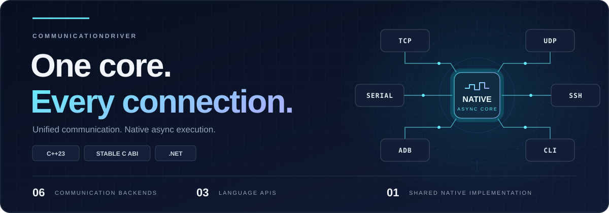
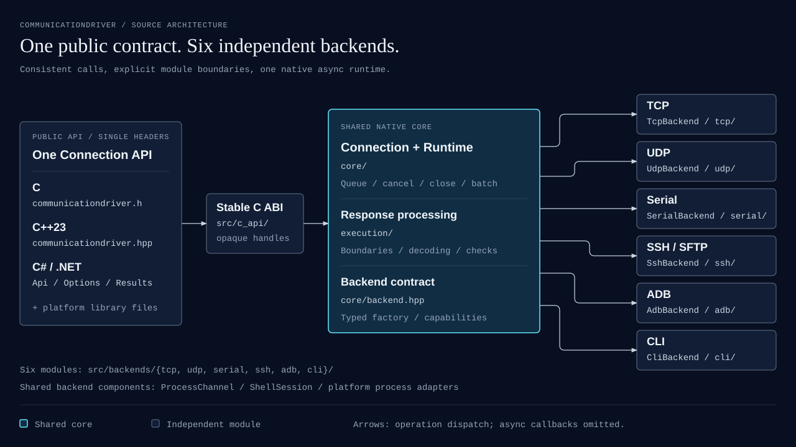

<div align="center">

# CommunicationDriver

**A shared native core for devices, networks, and command-line tools.**

One core. Every connection.

[](CMakeLists.txt)
[](#validation)
[](#validation)
[](#validation)
[](include/communicationdriver/communicationdriver.hpp)
[](bindings/dotnet/CommunicationDriver)
[](LICENSE)

[Quick Start](#quick-start) · [Build & Integration](#build) · [Agent Skill](#agent-skill) · [Platform Validation](#validation) · [Documentation](#docs)

</div>



CommunicationDriver is a cross-platform communication library for device control, automated testing, and multi-connection orchestration. It brings **TCP, UDP, Serial, SSH, ADB, and CLI** into a shared connection and operation model. A **C++23 native async core + stable C ABI** gives C, C++, and C# the same runtime semantics.

From a local shell command to parallel batches across devices, the workflow stays consistent: create a connection, open resources, perform an operation, check the response, and close the connection.

> **Current version: 0.1.2.** Native and NuGet packages include an agent skill with C, C++23, and C# usage guidance. Six-platform software acceptance and macOS / Windows device tests are recorded separately in the [validation report](docs/validation.md); physical serial ports and broader hardware coverage remain pending.

## Why CommunicationDriver

| Capability | What it gives you |
| --- | --- |
| **Six backends, one API** | A consistent `Open / Read / Write / Execute / Close` model across communication methods |
| **Shared native implementation** | A C ABI, C++ RAII wrappers, and C# `SafeHandle` / `Task` bindings backed by one async core |
| **Explicit response boundaries** | Complete responses by command completion, length, delimiter, regex, or UDP message; idle completion is an explicit choice |
| **Execution and checking** | `Execute` checks a complete response; `ExecuteUntil` matches incoming output and can return early |
| **Concurrent batch orchestration** | Default concurrency of 32, serial operations per connection, results in input order, and independent item failures |
| **Diagnosable failures** | Partial text, raw bytes, or file paths preserved on timeout, cancellation, and I/O errors to guide recovery |
| **Text and byte interfaces** | Raw-byte operations and UTF-8 / ASCII / GB18030 wire encoding for text commands and binary protocols |

## Six Ways to Connect

| Backend | Typical use | Configuration and behavior |
| --- | --- | --- |
| **TCP** | Network devices, test services, stream protocols | TCP client; define a complete response boundary with `ReceiveUntil` |
| **UDP** | Datagram protocols, fixed-peer devices | Fixed peer; supports UDP message boundaries; `Open` does not establish remote availability |
| **Serial** | Instruments, control boards, serial devices | Configurable baud rate, data bits, parity, stop bits, and flow control |
| **SSH** | Remote commands, persistent shells, SFTP | Password or private-key authentication; requires known_hosts or a SHA256 host fingerprint |
| **ADB** | Android shell commands, file upload and download | Fixed `DeviceSerial`; uses Android Platform Tools supplied by the caller |
| **CLI** | Local shells, toolchains, subprocesses | Persistent or one-shot execution, direct programs, arguments, working directories, and environment variables |

## Architecture: Six Modules, One Public Contract



[Editable diagram source](docs/assets/architecture.html) · [Architecture and source guide](docs/architecture.md)

Each backend has its own directory, configuration type, class header, and implementation under `src/backends/`: `tcp/`, `udp/`, `serial/`, `ssh/`, `adb/`, and `cli/`. The shared `core/` owns scheduling and lifecycle; `execution/` owns response boundaries, decoding, and checks; `c_api/` owns the stable ABI adapters. ADB and CLI reuse the asynchronous process component.

**Single-header delivery:** C consumers need only `communicationdriver.h`; C++23 consumers need only `communicationdriver.hpp`. Pair either header with the platform library and its runtime dependencies. Private implementation headers are excluded from installed and packaged headers.

`Create` copies and validates configuration; `Open` connects to a device or starts local resources. Operations are serialized within each connection and may run concurrently across connections. A normally closed connection can be opened again. Once the `Driver` is closed, connections cannot be created or reopened.

<a id="quick-start"></a>

## Quick Start

These CLI examples use the system's default shell and require no external device. Windows defaults to CMD; macOS and Linux default to sh. `echo READY` works in both default environments. First prepare the native library and language bindings using [Build & Integration](#build).

### C#: Execute, Await, Check

```csharp
using System;
using CommunicationDriver;

using var driver = new Driver();
using var connection = driver.CreateCli(new CliOptions
{
    ExecutionMode = ExecutionMode.OneShot
});

await connection.OpenAsync();

var result = await connection.ExecuteAsync(
    "echo READY",
    Check.Contains("READY")
);

Console.Write(result.Response);                       // READY
Console.WriteLine($"Verified: {result.Check.Passed}"); // Verified: True

await connection.CloseAsync();
```

The C# bindings provide synchronous and asynchronous methods and target `net48` and `net10.0`. This example uses modern C# top-level statements; traditional projects can place it inside `async Task Main`. Running net48 applications is supported only on Windows.

### C++23: RAII and Async Operation Handles

```cpp
#include <communicationdriver/communicationdriver.hpp>
#include <iostream>

int main() {
    comm::Driver driver;
    comm::CliOptions options;
    options.execution_mode = comm::ExecutionMode::OneShot;

    auto connection = driver.create_cli(options);
    connection.open();

    auto pending = connection.execute_async(
        "echo READY", comm::Check::contains("READY")
    );
    auto result = pending.get();

    std::cout << result.response;
    connection.close();
    return result.check->passed ? 0 : 1;
}
```

`Operation<T>` is a movable RAII handle. `get()` consumes its result once; `wait_for()` only observes completion. A `std::stop_token` can request cancellation. Dropping an operation handle does not cancel the operation. For the C interface, see [examples/c](examples/c).

### Switching to TCP: Define When a Response Is Complete

Suppose the service sends `END` at the end of each complete response:

```csharp
using var connection = driver.CreateTcp(new TcpOptions
{
    Host = "127.0.0.1",
    Port = 9000,
    ReceiveUntil = ReceiveUntil.Delimiter("END")
});

await connection.OpenAsync();
var result = await connection.ExecuteAsync(
    "STATUS\n", Check.Contains("READY")
);
await connection.CloseAsync();
```

`Delimiter` strips the delimiter from the returned content by default. Other options include `Bytes(n)`, `Characters(n)`, `Pattern(regex)`, and UDP-specific `Message()`. `Execute` does not automatically append a newline to raw-stream commands; the `\n` above is part of the protocol.

## From One Connection to Parallel Batches

Connections owned by the same `Driver` can participate in a batch. Here, `adb` and `serial` are already open, and the serial connection has a valid response boundary configured:

```csharp
var items = new[]
{
    BatchItem.Execute("UP01/adb", adb, "getprop ro.product.model"),
    BatchItem.Execute("UP01/serial", serial, "STATUS\n", Check.Contains("READY"))
};

var report = await Batch.RunAsync(items, new BatchOptions
{
    MaxConcurrency = 32
});

foreach (var item in report.Items)
    Console.WriteLine($"{item.Key}: {item.State}, passed={item.Succeeded}");
```

- **Scheduling:** different connections run concurrently; operations on the same connection remain serial. 32 is the default batch concurrency, not a limit on the total number of connections.
- **Results:** keys must be unique, and reports preserve input order. `Succeeded` accounts for both operation success and a passing check.
- **Failure and cancellation:** an item failure does not cancel other items. Batch cancellation preserves completed results and marks items not yet admitted as `NotStarted`.
- **Step barriers:** `await` the current batch before submitting the next one to advance multi-device workflows in stages.

## Runtime Semantics

| Operation or scenario | Contract |
| --- | --- |
| `Execute` | Sends once, collects through the completion boundary, then checks; a normal mismatch returns `Check.Passed = false` |
| `ExecuteUntil` | Sends once and continuously matches `Contains / Regex`; returns on a match, potentially before an `ExitCode` is available |
| Cleanup after an early match | Managed commands and streams with reliable protocol boundaries continue draining remaining output; the next transaction on that connection waits for cleanup |
| Raw-stream completion | Ordinary TCP / UDP / serial `Execute` requires a reliable `ReceiveUntil`; the library does not infer an idle interval |
| `ReceiveUntil.Idle(...)` | Explicitly completes on silence; a long application pause can end collection early, and raw-stream `Execute` then enters `NeedsRecovery` |
| Timeout and cancellation | Single-connection operation timeouts include time spent in the connection queue; errors preserve partial results and require recovery when response ownership is unclear |
| `NeedsRecovery` | Close and reopen the connection before continuing; no implicit resend, reconnect, or rollback of remote side effects |
| Text and checks | UTF-8 by default; character counts use Unicode scalar values; RE2 regex is case-sensitive, with no automatic trimming or ANSI removal |
| File transfer | Single-file operations, overwrite enabled by default; failures may leave partial files whose paths are reported in `ErrorInfo.PartialFile` |

Persistent shells preserve working-directory and environment state. One-shot execution uses isolated command output. When CLI `ExecutablePath` and `Arguments` are specified, the `Execute` command is the program's stdin content. See [API semantics](docs/api.md) for lifecycle, errors, encoding, and handle ownership details.

<a id="build"></a>

## Build & Integration

### Toolchain

| Component | Requirement |
| --- | --- |
| Native build | CMake **3.28+**, a compiler supporting the required C++23 features; the commands below use Ninja |
| C++23 features | `expected`, `coroutine`, `span`, and `stop_token`, checked during configuration |
| C# bindings | **.NET SDK 10**, producing `net48 / net10.0` assemblies |
| Unix SSH cryptography | OpenSSL development files; Windows uses system WinCNG |
| ADB backend | Android Platform Tools supplied by the caller; adb is not bundled |

CI uses GCC 14 on Linux, MSVC on Windows, and LLVM 21 on macOS. Dependency versions and source SHA256 hashes are pinned. See [dependencies and licensing](docs/dependencies.md).

```sh
git clone https://github.com/EurekaRaider/CommunicationDriver.git
cd CommunicationDriver

cmake -S . -B build -G Ninja -DCMAKE_BUILD_TYPE=Release
cmake --build build --parallel 4
ctest --test-dir build --output-on-failure
cmake --install build --prefix install

dotnet build bindings/dotnet/CommunicationDriver -c Release
```

Initial configuration downloads the pinned dependencies by default. To use installed dependencies, set `-DCD_FETCH_DEPENDENCIES=OFF`; Boost must be **1.92.0**, and RE2 and libssh2 must also be available. A custom LLVM installation on macOS requires appropriate libc++, SDK, and OpenSSL paths. Refer to the [CI toolchain configuration](.github/workflows/ci.yml).

### C / C++ Consumers

After installation, use the exported target in your consumer's CMake project:

```cmake
find_package(CommunicationDriver CONFIG REQUIRED)
target_link_libraries(your_app PRIVATE CommunicationDriver::communicationdriver)
```

Set `CMAKE_PREFIX_PATH` to the `install` directory when configuring the consumer. C++ consumers must enable C++23. See the [standalone C / C++ consumers](examples/consumer).

### C# and NuGet

Download the **`CommunicationDriver-NuGet`** artifact from a successful [Platform CI](https://github.com/EurekaRaider/CommunicationDriver/actions/workflows/ci.yml) run for the version you need. Place its `.nupkg` in a local NuGet feed, then reference **`CommunicationDriver` 0.1.2** using `PackageReference`. Distribution currently uses CI artifacts; the version in your project must match the downloaded package.

The merged package includes `net48 / net10.0`, native libraries for six RIDs, third-party licenses, and `skills/communicationdriver/`. Windows selects `win-x86 / win-x64` according to `PlatformTarget`. On Unix, set `RuntimeIdentifier` or `CommunicationDriverRid` as needed. Native library architecture must match the process.

The `dotnet build` command above produces the managed bindings; running an application also requires the matching native library. See the [PackageReference example](examples/dotnet/PackageConsumer) and the [packages.config example](examples/dotnet/LegacyConsumer) for package-based integration.

| Platform | Native library |
| --- | --- |
| Windows | `communicationdriver_native.dll` |
| Linux | `libcommunicationdriver_native.so` |
| macOS | `libcommunicationdriver_native.dylib` |

Native packages also include headers, required companion runtime libraries, and the Windows import library. [test_native_package.py](scripts/test_native_package.py) validates independent C / C++ linking and execution against a package.

<a id="agent-skill"></a>

## Agent Skill

The [CommunicationDriver skill](skills/communicationdriver/SKILL.md) helps agents write consumers using the actual public APIs. It covers all six connection types, response framing, text and binary operations, execution checks, cancellation and recovery, file transfers, batching, and resource ownership. Language-specific references are loaded as needed.

The same skill source is delivered with each library build:

| Delivery | Skill location |
| --- | --- |
| Source checkout | `skills/communicationdriver/` |
| Native RID package or NuGet package | `skills/communicationdriver/` inside the package |
| CMake installation | `<prefix>/share/communicationdriver/skills/communicationdriver/` with the default data directory |
| **`CommunicationDriver-Skill`** CI artifact | `CommunicationDriver-Skill-0.1.2.zip`, containing `skills/communicationdriver/` |

Copy the whole `communicationdriver` folder into your agent's skills directory, preserving `SKILL.md` and its references. Use the skill from the same library version. Agents that load Markdown instructions directly can read `SKILL.md` without installing it. For example: “Use the CommunicationDriver skill to write a C# TCP consumer with a protocol delimiter, response checking, and cancellation.” The skill is independent of any specific agent product.

CI checks that the standalone archive, every native package, and NuGet packages contain the complete skill with the same contents as the source checkout. To build the standalone archive locally, run `python3 scripts/package_skill.py`.

<a id="validation"></a>

## Platform Validation & Acceptance Scope

The latest completed six-platform baseline before the 0.1.1 packaging changes is commit [`7d1e40c`](https://github.com/EurekaRaider/CommunicationDriver/commit/7d1e40c08bc43f947099a6a6aa18b2343acb063c), with a successful [Platform CI run](https://github.com/EurekaRaider/CommunicationDriver/actions/runs/39036699365). The table records that CI coverage; device and longer stress runs below apply to their own identified builds. See the [validation report](docs/validation.md) for the evidence and limits.

| Platform / RID | Native · C · C++ | .NET 10 | .NET Framework 4.8 | OpenSSH / SFTP |
| --- | :---: | :---: | :---: | :---: |
| Linux x64 · `linux-x64` | ✓ | ✓ | — | ✓ |
| Linux ARM64 · `linux-arm64` | ✓ | ✓ | — | ✓ |
| macOS ARM64 · `osx-arm64` | ✓ | ✓ | — | ✓ |
| macOS Intel · `osx-x64` | ✓ | ✓ | — | ✓ |
| Windows x64 · `win-x64` | ✓ | ✓ | ✓ | Not tested |
| Windows x86 · `win-x86` | ✓ | ✓ | ✓ | Not tested |

Windows x86 validation runs a 32-bit process on an x64 runner. The Linux binary baseline is Ubuntu 24.04; compatibility with older systems requires separate validation.

Existing validation covers native behavior, standalone consumers, TCP fragmentation, UDP messages and encoding, virtual serial ports, simulated ADB, real local OpenSSH / SFTP, 32-connection batches, GC / cancellation / partial results, and AddressSanitizer regressions.

**Hour-long stress:** Windows x64 and Linux x64 completed concurrent native cancellation/close, mixed-connection, and C# disposal workloads. Linux also completed hour-long ASan/UBSan workloads. These runs apply to the historical binaries identified in the [Windows / Linux evidence](docs/evidence/soak-hour-windows-linux.json), with resource measurements and limitations explained in the validation report.

**macOS ARM64:** TCP, UDP, CLI, real loopback SSH/SFTP, and two USB Android 10 devices completed **30-minute** mixed phases on the same repaired native build: **242 load workers**, including **43 per ADB slot**. Functional checks, ASan mixed stress, resource snapshots, and cleanup passed. See the [anonymous evidence](docs/evidence/nonserial-30min-macos-arm64.json) and [reproduction guide](docs/nonserial-soak-testing.md).

**Windows x64:** TCP, UDP, CLI, real loopback SSH/SFTP, one USB Android device, and a default CMD batch completed **30-minute core workloads**. CLI/ADB resource-sampler finalization initially failed; targeted checks passed after the sampler fix, without repeating the entire 30-minute run. A subsequent **10-minute dual-ADB** run completed with the corrected sampler. See the [Windows evidence](docs/evidence/nonserial-30min-windows-x64.json) and [dual-device evidence](docs/evidence/dual-adb-10min-windows-x64.json). Windows SSH/SFTP was exercised locally with AsyncSSH; the platform CI table above refers to its separate OpenSSH coverage.

Physical serial ports, broader Android/host combinations, and overnight device tests remain unverified. Query each connection's `Capabilities` for supported operations. TCP provides client connections; transfers operate on single files. Full PTY/TUI emulation, TCP servers, recursive transfers, automatic retries, and UDP delivery guarantees are not provided.

<a id="docs"></a>

## Documentation

| Document / example | Contents |
| --- | --- |
| [Agent skill](skills/communicationdriver/SKILL.md) | Portable consumer-writing guidance with C, C++23, C#, and integration references |
| [Architecture and source guide](docs/architecture.md) | Module responsibilities, six backend classes, dependencies, and single-header distribution |
| [0.1.2 refactor validation](docs/evidence/architecture-refactor-macos-arm64.json) | ABI compatibility, sanitizer suites, dual-device ADB, package consumers, and performance comparisons |
| [API and runtime semantics](docs/api.md) | Lifecycle, completion boundaries, cancellation, recovery, batches, and handle ownership |
| [Validation report](docs/validation.md) | Local tests, platform CI, package consumption, soak-test evidence, and hardware acceptance scope |
| [Dependencies, toolchain, and licensing](docs/dependencies.md) | Pinned versions, system dependencies, distribution requirements, and compatibility baselines |
| [Approved plan](docs/approved-plan.md) | Project scope and acceptance criteria |
| [C API](include/communicationdriver/communicationdriver.h) · [C++ wrappers](include/communicationdriver/communicationdriver.hpp) | Public native interfaces |
| [C# contracts](bindings/dotnet/CommunicationDriver) | Configuration, checks, results, and error types |
| [C examples](examples/c) · [C++ examples](examples/cpp) · [C# examples](examples/dotnet/Consumer) | Runnable language consumers |

## License

Project source is licensed under the [MIT License](LICENSE). Third-party licenses are included in native and NuGet packages. See [dependencies and licensing](docs/dependencies.md).
